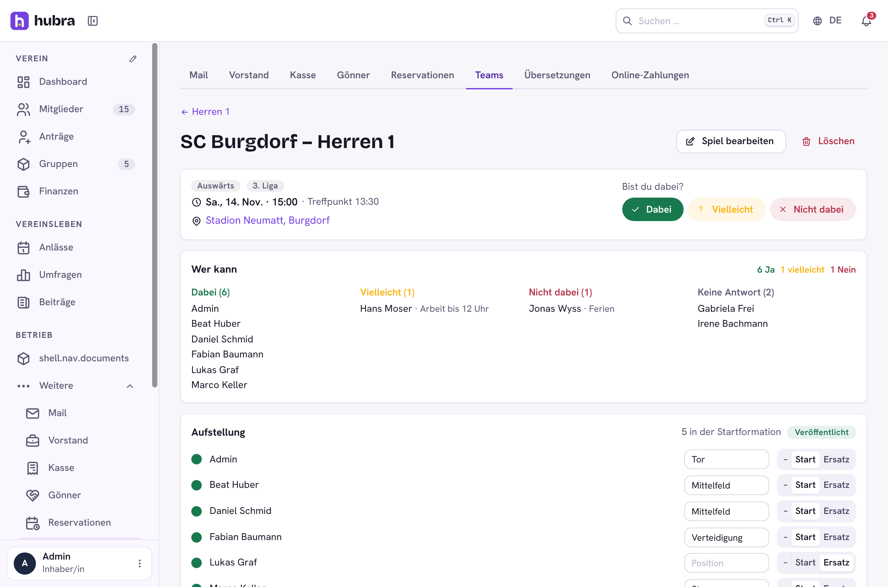

# Teams

  

A plugin for [Hubra](https://hubra.club). Match days for team sports: fixtures from the league's calendar feed, who can play, the coach's line-up, and carpooling to away games.

**Version** 1.0.0 · **Works with** Hubra >=0.2,<1 · **Plugin id** `teams` · **Needs** the members and groups modules (and events, to show matches in the club calendar)

## What it does

A team is one of the club's groups: its members are the players, and its
lead is the coach (as is anyone with `teams.matches.update`).

| Part | |
| --- | --- |
| Fixtures | The coach adds matches, or links the league's iCal calendar (webcal or https). Hubra reads it every hour: new matches come in, moved ones are updated, future ones that left the feed are marked called off. The team's name in the feed tells home from away. Matches can also show in the club calendar (Anlässe, category "competition"). |
| Availability | Players answer Dabei, Vielleicht or Nicht dabei, with an optional note, on the team list, the team page or the match. Three days before a match, those who haven't answered get a bell notification. |
| Line-up | The coach picks starters and substitutes with a position, saves a draft, then publishes it. Those picked get a notification and see "Du spielst" on the match. |
| Carpooling | A player offers seats with a meeting point and time; teammates take a seat (one per match). If the driver withdraws, the riders are told. |

Only public https hosts are fetched for feeds (`TEAMS_FEED_ALLOW_PRIVATE=1`
lifts that for a local test server); feeds are capped at 2 MB.

Permissions: `teams.teams.update` (set up teams and feeds),
`teams.matches.update` (coach every team). Every member sees the teams and
their fixtures; answers, line-ups and rides are for the team.

## Install

Platform admins install it from the plugin catalogue in the manager portal
(official Marketplace, <https://plugins.hubra.club/index.json>, signed with
the Hubra project key). Clubs then switch it on under Einstellungen → Module
& Plugins.

## Develop

Clone this repository into `plugins/teams` of a Hubra checkout. Its tests
then run with Hubra's (`cd app/backend && pytest ../../plugins/teams`), and
`npm run build:plugin` in `app/frontend` builds its frontend. The workflow
does the same against Hubra's `main` on every push and pull request.

## Releasing

Bump `version` in `plugin.yaml`, add a `## <version>` section to
`CHANGELOG.md`, commit, then publish a GitHub release tagged `v<version>`
(web UI, or `gh release create v<version> --target main --notes ""`). The
workflow tests the plugin and builds its frontend; a separate job in the
`plugin-signing` environment, the only one with the `HUBRA_SIGNING_KEY`
secret, signs it; then `teams-<version>.zip` is attached to the release. Files listed in `.releaseignore` stay out of the zip.

Source: <https://github.com/hubra-app/hubra-plugin-teams>
